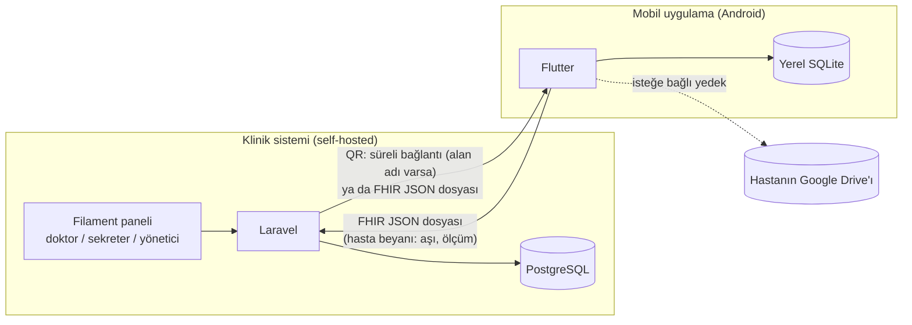

# Lokman — Proje Planı

> Durum: **taslak, soru-cevapla netleşiyor.** Kararlar bölümü kesinleşen maddeleri, "Açık konular" bölümü henüz cevaplanmamış soruları içerir.

Lokman, özel klinikler için açık kaynak hasta takip sistemidir ve **birbirinden bağımsız iki üründen** oluşur:

1. **Klinik sistemi (web)**: Kliniğin kendi sunucusunda çalışır (self-hosted, tek klinik). Doktor ve personel veriyi burada üretir.
2. **Mobil uygulama (Flutter, Android)**: Hastanın kişisel sağlık defteridir. Veri telefonda durur. Hasta hesabı ve sunucu yoktur.

İki ürün arasındaki **tek bağ HL7 FHIR R4 formatında dışa ve içe aktarımdır**. Aktarım QR kod ya da dosya ile yapılır.



---

## 1. Alınan kararlar

| Konu | Karar |
|---|---|
| Backend | Laravel (PHP), REST |
| Veritabanı | PostgreSQL |
| Klinik paneli | Laravel + Filament, backend ile aynı proje |
| Kurulum | Tek klinik, self-hosted, Docker Compose |
| Kullanıcılar | Çok kullanıcılı: personel aynı sisteme **e-posta + şifre** ile girer, rol bazlı yetki uygulanır |
| Mobil | Flutter, ilk hedef **Android APK** |
| Mobil ↔ klinik | Doğrudan bağlantı yok, hasta hesabı yok. Yalnızca FHIR dışa ve içe aktarımı |
| Aktarım yolu | Klinik alan adına sahipse **QR kod**, içinde süreli indirme bağlantısı bulunur. Alan adı yoksa **dosya** ile |
| Veri formatı | **HL7 FHIR R4**, düz JSON (şifrelenmemiş) |
| Kimlik | **TCKN temelli değil.** Birincil anahtar UUID. TCKN, pasaport gibi kimlikler opsiyonel ek bilgidir |
| Mobil profiller | **Aile profilleri**: tek uygulamada birden fazla kişi (ör. anne ve çocukları) |
| Mobil yedek | **İsteğe bağlı Google Drive yedeği** |
| Birden çok klinik | Mobil uygulama farklı kliniklerden gelen dosyaları aynı profilde birleştirir. Klinik sistemi tek kliniktir |
| Terminoloji | Teşhis için ICD-10, ilaç için ATC, ölçümler için LOINC, birimler için UCUM. İleride SNOMED CT |
| Kod dili | Kod tanımlayıcıları İngilizce (Laravel ve Flutter gelenekleri), arayüz Türkçe |
| Roller | Yönetici, doktor, sekreter. Sekreter muayene notlarını, teşhisleri ve reçeteleri göremez |
| Randevu | İlk sürümde var. Her doktor kendi randevularını girer ve yönetir |
| QR bağlantı süresi | Klinik ayarlar: süre ve kullanım sayısı yönetici ayarlarındadır. Varsayılan 15 dk, tek kullanım |

---

## 2. Klinik sistemi (web)

### 2.1 Modüller
| Modül | İçerik |
|---|---|
| Hasta kaydı | Ad, soyad, doğum tarihi, cinsiyet, iletişim, alerjiler, kronik hastalıklar, acil durum kişisi. Opsiyonel kimlikler (TCKN, pasaport…). Klinik içi protokol numarası |
| Muayene | Şikayet, bulgular, iç not (hastaya gitmez), vital ölçümler |
| Teşhis / hastalık | ICD-10 katalogundan arama, birincil ve ikincil teşhis |
| Reçete | İlaç katalogundan seçim (ATC), doz ve birim, **kullanım saatleri** (08:00, 20:00…), başlangıç tarihi, süre ya da sürekli kullanım, aç/tok notu |
| Aşı kaydı | Klinikte yapılan aşı (lot no, uygulayan), sonraki doz tarihi, ulusal aşı takvimi şablonu. Hastanın getirdiği aşıları **onaylama kuyruğu** |
| Sağlık ölçümleri | Tansiyon, şeker, kilo, boy, nabız, ateş, SpO₂. Normal aralık uyarısı |
| Paylaşım | Hasta için QR (süreli bağlantı) ya da FHIR dosyası üretme, hastadan gelen dosyayı içe aktarma |
| Randevu | Doktor kendi takvimini yönetir: randevu ekler, taşır, iptal eder, "geldi/gelmedi" işaretler. Randevudan tek tıkla muayene açılır. Hastanın gelecek randevuları paylaşım paketine eklenir |
| Kataloglar | İlaç, ICD-10, aşı. Excel/CSV ile toplu yükleme |
| Yönetim | Kullanıcılar, roller, klinik ayarları, erişim logu |

### 2.2 Roller
| Rol | Yetki |
|---|---|
| Yönetici | Her şey: kullanıcı yönetimi, ayarlar, erişim logu, hasta silme |
| Doktor | Muayene, teşhis, reçete, aşı, onaylar, paylaşım. **Yalnızca kendi randevuları** |
| Sekreter | Hasta kaydı, aşı ve ölçüm girişi, paylaşım. Muayene notlarını, teşhisleri ve reçeteleri **göremez, giremez**. Randevular doktora aittir (sekreterin randevu yetkisi gerekirse sonra eklenir) |

### 2.3 Veri modeli (taslak)
Tüm tablolarda birincil anahtar **UUID**'dir. Böylece FHIR `id` alanı kararlı kalır ve tekrarlanan aktarımlar mükerrer kayıt üretmez.

```
users              (id, name, email, password, role, active)
patients           (id, protocol_no, first_name, last_name, birth_date, gender, phone, email,
                    address, allergies, chronic_conditions, emergency_contact_*, notes, timestamps)
patient_identifiers(id, patient_id, type /*tckn|passport|other*/, value)        -- opsiyonel
encounters         (id, patient_id, doctor_id, started_at, complaint, findings, internal_note)
conditions         (id, encounter_id, icd10_code, description, rank /*primary|secondary*/)
prescriptions      (id, encounter_id NULL, patient_id, doctor_id, issued_at, note)
prescription_items (id, prescription_id, medication_id NULL, medication_name, atc_code,
                    dose, dose_unit, times_of_day JSON, start_date, duration_days NULL,
                    instructions, stopped_at NULL)
immunizations      (id, patient_id, encounter_id NULL, vaccine_id NULL, vaccine_name, vaccine_code,
                    dose_number, administered_on, lot_number, performer_id NULL,
                    next_dose_on NULL, source /*clinic|patient_reported*/, verified, verified_by, verified_at)
observations       (id, patient_id, encounter_id NULL, type, value, value2 NULL, unit,
                    measured_at, source /*clinic|patient_reported*/, verified)
appointments       (id, doctor_id, patient_id, starts_at, ends_at, status /*planned|arrived|no_show|cancelled*/,
                    note, encounter_id NULL)
share_links        (id, patient_id, token_hash, scope JSON, expires_at, max_uses, use_count, created_by)
settings           (key, value)   -- ör. share_link_ttl_minutes, share_link_max_uses, installation_id
imports            (id, file_name, imported_by, summary JSON, created_at)
consents           (id, patient_id, type, version, given_at, recorded_by)          -- KVKK açık rıza
access_logs        (id, user_id, action, subject_type, subject_id, patient_id, ip, at)
medications, icd10_codes, vaccines, vaccine_schedule_templates                    -- kataloglar
```

### 2.4 Teknoloji
- PHP 8.x, Laravel, Filament (güncel kararlı sürümler, kurulumda sabitlenecek)
- `spatie/laravel-permission` (roller)
- Pest (testler)
- FHIR dönüştürücü: kendi mapper sınıflarımız. Üretilen paketler CI'da resmi HL7 FHIR Validator ile doğrulanacak
- Docker Compose: `caddy` (alan adı varsa otomatik HTTPS), `php-fpm`, `postgres`, `queue`, `scheduler`

---

## 3. Mobil uygulama (Flutter, Android)

### 3.1 Ekranlar
| Ekran | İçerik |
|---|---|
| Profiller | Aile üyeleri. Her profilin hangi kliniklere bağlı olduğu |
| Bugün | Günün ilaç dozları (aldım / atladım), yaklaşan aşılar, son ölçümler |
| Muayeneler | Klinik, tarih, doktor, şikayet, bulgular, teşhisler, reçeteler |
| İlaçlarım | Aktif ilaçlar, kullanım saatleri, bitiş tarihi, uyum oranı |
| Aşılar | Yapılan aşılar, aşı takvimi (gecikmiş / yaklaşan), hastanın kendi girdiği aşılar ("doğrulanmadı" etiketiyle) |
| Sağlık takibi | Ölçüm girişi ve grafikler |
| İçe aktar | QR okut ya da dosya aç |
| Dışa aktar | Seçili profil ve kayıtlar için FHIR JSON dosyası, Android paylaş menüsü ile |
| Ayarlar | Bildirim tercihleri, isteğe bağlı Google Drive yedeği ve geri yükleme |

### 3.2 Teknik
- Yerel veritabanı: SQLite (`drift`). Her kaynağın ham FHIR JSON'u da saklanır, böylece dışa aktarım kayıpsız olur
- Bildirimler: `flutter_local_notifications` + `timezone`
  - Doz saatleri ve aşı tarihleri cihazda zamanlanır
  - Telefon yeniden başlayınca bildirimler yeniden kurulur
  - Android 13+ bildirim izni ve Android 12+ tam zamanlı alarm izni istenir
- QR: `mobile_scanner`. Dosya: Android paylaş menüsünden ya da dosya seçiciyle açma
- Yedek: Google Drive `appDataFolder` (uygulamaya özel gizli klasör), elle ya da periyodik
- Durum yönetimi `riverpod`, yönlendirme `go_router`, grafikler `fl_chart`

---

## 4. FHIR değişim sözleşmesi

İki ürünün konuştuğu tek dil budur. Ayrıntıları `docs/fhir-sozlesmesi.md` dosyasında olacak. `fhir/examples/` altındaki örnek paketleri iki tarafın testleri de kullanacak.

### 4.1 Kaynak eşleşmesi
| Lokman | FHIR R4 kaynağı |
|---|---|
| Hasta | `Patient` |
| Muayene | `Encounter` (bulgular extension ile) |
| Teşhis / hastalık | `Condition` (ICD-10) |
| Reçete kalemi | `MedicationRequest` (aynı reçete `groupIdentifier` ile gruplanır; saatler `timing.repeat.timeOfDay` alanında) |
| Aşı | `Immunization` |
| Sonraki aşı dozu | `ImmunizationRecommendation` |
| Ölçüm | `Observation` (LOINC + UCUM, tansiyon `component` ile) |
| Alerji / kronik hastalık | `AllergyIntolerance` / `Condition` (problem listesi) |
| Randevu | `Appointment`: mobilde gelecek randevu ve hatırlatma |
| Kliniğin kendisi | `Organization`: mobilde "hangi klinikten geldi" bilgisi |

### 4.2 Kimlik ve eşleştirme (TCKN'siz)
- Her klinik kurulumu ilk açılışta kalıcı bir **kurulum kimliği** (UUID) üretir.
- `Patient.identifier`: `system = urn:lokman:<kurulum-uuid>:patient`, `value = <hasta UUID>`. Varsa TCKN ve pasaport da ek identifier olarak eklenir, ama eşleştirmede zorunlu değildir.
- **Mobilde içe aktarma:** identifier daha önce görüldüyse ilgili profile eklenir. Görülmediyse kullanıcıya "hangi profil?" sorulur; ad ve doğum tarihine göre öneri yapılır.
- **Klinikte içe aktarma:** dosyadaki kendi identifier'ı ile hasta otomatik bulunur. Bulunamazsa elle eşleştirilir.
- Kaynak `id`'leri kararlı UUID'dir. Aynı dosya iki kez aktarılırsa kayıt güncellenir, mükerrer oluşmaz.

### 4.3 Klinik → telefon
**A. QR (klinik alan adına sahipse)**
1. Panelde, hasta sayfasında "Mobil uygulamaya aktar" seçilir. Kapsam belirlenir: tüm kayıt ya da seçili muayene(ler).
2. Sunucu rastgele bir token üretir. Veritabanında yalnızca token'ın hash'i tutulur. Bağlantının **süresi ve kullanım sayısı klinik ayarlarından** gelir (varsayılan 15 dk, tek kullanım).
3. QR içeriği: `https://<alan-adi>/fhir/share/<token>`
4. Uygulama QR'ı okur, bağlantıdan FHIR Bundle'ı **yalnızca HTTPS** ile indirir. Süresi dolmuş ya da kullanım hakkı bitmiş bağlantı `410 Gone` döner. Her indirme erişim loguna yazılır. Panelden bağlantı erken iptal edilebilir.

**B. Dosya (alan adı yoksa ya da tercih edilirse)**
- Panel `.json` FHIR paketini indirir. Hasta dosyayı e-posta, WhatsApp, USB ile alır ve uygulamada açar.

### 4.4 Telefon → klinik
- Uygulama seçili kayıtları (hastanın girdiği aşılar, ölçümler) FHIR JSON dosyası olarak dışa aktarır.
- Klinik paneli dosyayı içe aktarır. Hastanın girdiği kayıtlar `source = patient_reported`, `verified = false` olarak **onay kuyruğuna** düşer. Doktor onaylayınca doğrulanmış olur.

---

## 5. Güvenlik ve KVKK

Sağlık verisi KVKK kapsamında **özel nitelikli kişisel veridir**.
- **Açık rıza ve aydınlatma:** klinikte rıza kaydı tutulur (`consents`). QR ya da dosya paylaşımından önce rıza kontrol edilir.
- **Aktarım:** QR bağlantısı yalnızca HTTPS ile çalışır, süresi ve kullanım sayısı sınırlıdır. Yönetici süreyi uzatırsa (ör. yazdırılıp verilen QR) risk artar; ayar ekranında uyarı gösterilir.
- **Düz JSON dosya riski:** dosya şifrelenmediği için yanlış kişiye giderse okunabilir. Panelde paylaşım öncesi uyarı gösterilir ve indirme erişim loguna yazılır. Şifreli paket ileride eklenebilir.
- **Depolama:** klinikte PostgreSQL ve yedekler kurumun sorumluluğundadır (kurulum dokümanında öneriler yer alacak). Mobilde veri Android uygulama alanında durur. Drive yedeği kullanıcının kendi hesabına gider.
- **Yetkilendirme:** rol bazlı (Laravel Policy). Mobilde kullanıcı yoktur.
- **Erişim logu:** hasta görüntüleme, değişiklik, dışa aktarma, paylaşım, içe aktarma.

---

## 6. Depo yapısı (öneri)
```
lokman/
├── backend/          Laravel + Filament (klinik sistemi)
├── mobile/           Flutter (hasta uygulaması)
├── fhir/examples/    Örnek FHIR paketleri (iki tarafın sözleşme testleri)
├── docs/             PLAN.md, fhir-sozlesmesi.md, kurulum.md
└── docker-compose.yml
```

---

## 7. Fazlar

| Faz | Kapsam | Çıktı |
|---|---|---|
| **F0: Temel** | Depo, Docker Compose, Laravel + Filament iskeleti, Flutter iskeleti, CI (Pest, `flutter test`, FHIR validator), FHIR sözleşmesi ve örnek paketler | Çalışan boş panel + boş APK |
| **F1: Klinik çekirdek** | Kullanıcılar/roller, hasta kaydı, doktor randevuları, muayene → teşhis (ICD-10), reçete (ilaç katalogu, doz saatleri), erişim logu | Randevu, muayene ve reçete yazılabilen panel |
| **F2: Aşı ve ölçüm** | Aşı kaydı, sonraki doz, ulusal aşı takvimi, ölçümler, hasta beyanı onay kuyruğu | |
| **F3: Klinik aktarım** | FHIR dışa aktarım, QR süreli bağlantı, dosya indirme, FHIR içe aktarım ve onay akışı | Panelden QR/dosya üretimi |
| **F4: Mobil MVP** | Aile profilleri, QR/dosya ile içe aktarma, muayene geçmişi, ilaçlar ve doz hatırlatma, aşı takvimi ve hatırlatma, randevu hatırlatma, ölçüm girişi ve grafik, dışa aktarma | **İlk Android APK** |
| **F5: Yayın** | Drive yedeği, KVKK ekranları, APK imzalama, kurulum dokümanı, demo verisi | v0.1 sürümü |
| Sonra | e-Nabız / e-Reçete dönüştürücü katmanı, iOS, şifreli paket, sekreter randevu yetkisi | |

---

## 8. Açık konular
- [ ] Randevu: süre/slot ayarı (ör. 15–20 dk), çakışma kontrolü, hastaya SMS/e-posta hatırlatma olacak mı?
- [ ] Alan adı olmadan aynı Wi-Fi ağında QR (yerel IP) desteklensin mi?
- [ ] Telefon → klinik yönünde de QR (klinik ekranında yükleme QR'ı) olsun mu, yoksa yalnızca dosya mı?
- [ ] İlaç katalogunun kaynağı (ör. TİTCK ilaç listesi Excel'i ile yükleme)
- [ ] Lisans (AGPL-3.0 / GPL-3.0 / MIT)
- [ ] Ödeme / fatura modülü (şimdilik kapsam dışı)
- [ ] e-Nabız ve e-Reçete entegrasyonunun kapsamı ve zamanı. Güncel format Sağlık Bakanlığı dokümanlarından doğrulanacak
