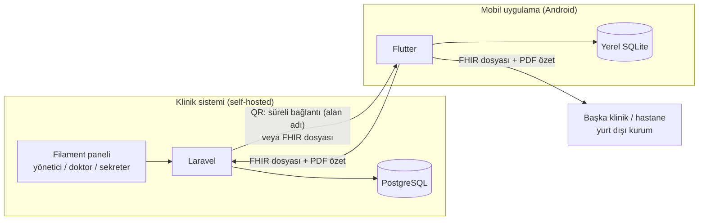

# Lokman — Proje Planı

> Durum: **plan onaylandı (v1). Kodlamaya henüz başlanmadı.**
> Veritabanı tasarımı: [VERITABANI.md](VERITABANI.md)

Lokman, özel klinikler için açık kaynak (MIT) hasta takip sistemidir ve **birbirinden bağımsız iki üründen** oluşur:

1. **Klinik sistemi (web)**: Kliniğin kendi sunucusunda çalışır (self-hosted, tek klinik). Doktor ve personel veriyi burada üretir.
2. **Mobil uygulama (Flutter, Android)**: Hastanın kişisel sağlık defteridir. Veri telefonda durur; hasta hesabı ve sunucu yoktur.

İki ürün arasındaki **tek bağ, HL7 FHIR R4 (IPS uyumlu) formatında dışa ve içe aktarımdır**. Aktarım QR kod ya da dosya ile yapılır. Veri hastanındır: hasta verisini başka bir Lokman kliniğine, herhangi bir hastaneye ya da yurt dışındaki bir kuruma götürebilir.



> **v0.1 kapsamı:** ilk sürüm sade tutulur. Yerel ağ QR'ı, Google Drive yedeği ve mobilde ulusal aşı takvimi önerileri v0.1'e girmez (bkz. [7. Sonra](#sonra)).

---

## 1. Kararlar

### 1.1 Mimari ve teknoloji
| Konu | Karar |
|---|---|
| Backend | Laravel (PHP) |
| Veritabanı | PostgreSQL |
| Klinik paneli | Laravel + Filament, backend ile aynı proje |
| Kurulum | Tek klinik, self-hosted, Docker Compose |
| Mobil | Flutter, ilk hedef **Android APK** |
| Lisans | MIT |
| Hedef ülkeler | Türkiye ve KKTC |
| Resmî sistemler | e-Nabız / e-Reçete entegrasyonu **zorunlu değil** ve v0.1'de yok (KKTC'de de kullanılacağı için ürün bunlara bağlı tasarlanmaz) |
| Kod dili | Kod tanımlayıcıları İngilizce (Laravel/Flutter gelenekleri), arayüz Türkçe |

### 1.2 Kullanıcılar ve roller
| Konu | Karar |
|---|---|
| Giriş | Çok kullanıcılı: personel aynı sisteme **e-posta + şifre** ile girer |
| Roller | Yönetici, doktor, sekreter. Sekreter **klinik içeriği** göremez ve dışarı veremez (bkz. 2.2) |
| Randevu | Doktor kendi randevularını, sekreter tüm doktorların randevularını girer ve yönetir. Aynı doktora çakışan randevu verilemez |
| Hasta hesabı | Yok. Mobil uygulama sunucuya bağlanmaz |

### 1.3 Hasta ve klinik veri
| Konu | Karar |
|---|---|
| Kimlik | **TCKN temelli değil.** Birincil anahtar UUID. TCKN, pasaport gibi kimlikler opsiyoneldir |
| TCKN saklama | Veritabanında düz saklanır (arama ve doğrulama için). Koruma: veritabanı/disk düzeyinde şifreleme, rol bazlı erişim, erişim logu |
| Protokol numarası | Yıl + sıra: `2026-000123` |
| Alerji / kronik hastalık | Ayrı, yapısal tablolar. Hasta beyanı da kabul edilir (onay akışıyla). İlaç alerjisi etken madde ya da ATC koduyla kodlanır (ilaç–alerji uyarısı için) |
| Muayene | Şikayet, hikaye, bulgular, **öneriler (hastaya gider)** ve **iç not (hastaya gitmez)** ayrı alanlar |
| Teşhis | ICD-10, birincil/ikincil, **ön tanı / kesin tanı** |
| Reçete | Reçete türü (normal / kırmızı / yeşil / mor / turuncu), kutu adedi, doz, **kullanım saatleri**, süre ya da sürekli kullanım |
| İlaç katalogu | **TİTCK ilaç listesi** (Excel) panelden içe aktarılır ve güncellenir |
| Aşı | Yapılan aşılar (`immunizations`) ve **planlanan aşılar** (`planned_immunizations`) ayrı tablolar. Ulusal aşı takvimi öneri olarak hesaplanır |
| Hasta beyanı | Hastanın getirdiği aşı, alerji, kronik hastalık ve ölçümler **onay kuyruğuna** düşer |
| Dış kaynaklı kayıtlar | Başka kurumdan gelen muayene, teşhis, reçete, aşı, ölçüm, alerji ve kronik hastalıklar aynı tablolara `source = external` ile, kurum adıyla ve salt okunur eklenir. Onay kuyruğuna girmez |
| Katalogda olmayan kod | Dışarıdan gelen ve katalogda bulunmayan kod (ör. ICD-10-CM, bilinmeyen LOINC) reddedilmez; ham kodlama kayıtta saklanır, katalog bağlantısı boş kalır |
| Silme | Tıbbi kayıtlar yumuşak silinir; her işlem erişim loguna yazılır |

### 1.4 Aktarım (mobil ↔ klinik ↔ diğer kurumlar)
| Konu | Karar |
|---|---|
| Format | **HL7 FHIR R4**, **IPS** (International Patient Summary) profiline uyumlu, düz JSON |
| Klinik → telefon | Alan adı varsa **QR** (süreli HTTPS bağlantısı). Alan adı yoksa **dosya**. Yerel ağ QR'ı v0.1 sonrasına ertelendi |
| QR süresi | Klinik ayarlar. Varsayılan 15 dk, tek kullanım |
| Telefon → klinik / kurum | **Dosya**. Profilin tüm verisi ya da seçilen kayıtlar |
| Okunabilir özet | Her dışa aktarımla **iki dilli PDF özet** (panel ve mobil üretir) |
| Dil | Serbest metin Türkçe. Kodlu alanlarda (teşhis, aşı, etken madde, ölçüm türü) Türkçe + İngilizce ad |
| İlaç uyumu | "Aldım / atladım" kayıtları yalnızca mobilde kalır, dışa aktarılmaz |
| Terminoloji | ICD-10 (teşhis), ATC (ilaç), LOINC (ölçüm), UCUM (birim). İleride SNOMED CT |

### 1.5 Mobil
| Konu | Karar |
|---|---|
| Profiller | Aile profilleri. Ebeveyn çocuğu için klinik dosyası olmadan profil açıp alerji, aşı, ölçüm girebilir |
| Birden çok klinik | Farklı kliniklerden gelen veriler aynı profilde birleşir |
| Bildirimler | Cihazda zamanlanır: ilaç doz saatleri, planlanan aşılar, randevular |
| Aşı takvimi | v0.1'de mobil yalnızca klinikten gelen planlanan aşıları gösterir; ulusal takvim önerileri sonra |
| Şifreleme | Uygulama içinde ek şifreleme ya da uygulama kilidi yok. Veri, telefonun kendi ekran kilidi ve Android'in uygulama alanı korumasıyla korunur |
| Yedek | v0.1'de yok. Kullanıcı tüm veriyi FHIR dosyası olarak dışa aktarıp saklayabilir; Google Drive yedeği sonra |

---

## 2. Klinik sistemi (web)

### 2.1 Modüller
| Modül | İçerik |
|---|---|
| Hasta kaydı | Kimlik bilgileri, iletişim, acil durum kişisi, opsiyonel kimlikler, protokol no, alerjiler, kronik hastalıklar, KVKK rızaları |
| Randevu | Doktor bazında günlük/haftalık takvim. Ekle, taşı, iptal et, "geldi / gelmedi". Randevudan tek tıkla muayene |
| Muayene | Şikayet, hikaye, bulgular, öneriler, iç not, vital bulgular. Hastanın geçmişi (dış kaynaklı kayıtlar dahil) tek zaman çizelgesinde |
| Teşhis | ICD-10 arama, birincil/ikincil, ön/kesin tanı |
| Reçete | TİTCK katalogundan ilaç, doz, kullanım saatleri, süre, kutu, reçete türü. **İlaç–alerji uyarısı** (etken madde / ATC eşleşmesi) |
| Aşı | Aşı kaydı (lot, son kullanma, uygulayan), planlanan aşılar, ulusal takvim önerileri, "gecikmiş" ve "bu hafta" listeleri |
| Ölçümler | Ölçüm girişi, normal aralık uyarısı, trend grafikleri (hastanın girdikleri dahil) |
| Onay kuyruğu | Hasta beyanı aşı, alerji, kronik hastalık ve ölçümleri onayla/reddet |
| Paylaşım | QR (internet), FHIR dosyası ve PDF özet indirme, aktif bağlantıları iptal |
| İçe aktarım | FHIR dosyası yükleme, hasta eşleştirme (otomatik ya da elle / yeni hasta), içe aktarım geçmişi. Sekreter yalnızca kimlik bilgilerini ve kayıt sayılarını görür, paket içeriğini göremez |
| Kataloglar | İlaç (TİTCK), ICD-10, ATC alerji grupları (proje yazar; WHO listesi dağıtılmaz), aşı ve aşı takvimi, ölçüm türleri |
| Yönetim | Kullanıcılar, roller, klinik ayarları (QR süresi, alan adı), erişim logu |

### 2.2 Rol–yetki matrisi

**Klinik içerik** (sekreter göremez, dışa aktaramaz): muayeneler (iç not dahil), teşhisler, reçeteler, kronik hastalıklar, hasta iç notu ve FHIR paketlerinin içeriği.
**Sekreterin gördüğü:** kimlik ve iletişim bilgileri, randevular, rızalar, alerjiler (güvenlik bilgisi), aşılar ve ölçümler (sekreter bunları girebildiği için).

| İşlem | Yönetici | Doktor | Sekreter |
|---|:-:|:-:|:-:|
| Hasta kaydı oluştur / düzenle | ✓ | ✓ | ✓ |
| Hasta sil (yumuşak) | ✓ | | |
| Randevu (kendi) | ✓ | ✓ | |
| Randevu (tüm doktorlar) | ✓ | | ✓ |
| Muayene, teşhis, reçete: görüntüle | ✓ | ✓ | |
| Muayene, teşhis, reçete: yaz | | ✓ | |
| Aşı ve ölçüm girişi | ✓ | ✓ | ✓ |
| Planlanan aşı | ✓ | ✓ | ✓ |
| Onay kuyruğu | | ✓ | |
| QR / dosya paylaşımı (FHIR + PDF) | ✓ | ✓ | |
| FHIR içe aktarım: dosya yükleme ve hasta eşleştirme | ✓ | ✓ | ✓ (paket içeriğini görmeden) |
| Kataloglar | ✓ | ✓ (ilaç/ICD görüntüleme) | |
| Kullanıcılar, ayarlar, erişim logu | ✓ | | |

> Yöneticinin muayene yazma yetkisi yok; yönetici aynı zamanda hekimse ikinci bir doktor hesabı kullanır (ya da ileride çoklu rol desteklenir).

### 2.3 Teknoloji
- PHP 8.x, Laravel, Filament (güncel kararlı sürümler, kurulumda sabitlenir)
- `spatie/laravel-permission` (roller), Laravel Policy (kayıt düzeyi yetki)
- Pest (testler), Larastan (statik analiz), Pint (kod biçimi)
- FHIR: kendi mapper sınıflarımız (`app/Fhir`). Üretilen paketler CI'da HL7 FHIR Validator (IPS profili) ile doğrulanır
- PDF: Laravel tarafında HTML → PDF
- Docker Compose: `caddy` (alan adı varsa otomatik HTTPS), `php-fpm`, `postgres`, `queue`, `scheduler`

---

## 3. Mobil uygulama (Flutter, Android)

### 3.1 Ekranlar
| Ekran | İçerik |
|---|---|
| Profiller | Aile üyeleri, profil ekleme (klinik dosyası olmadan da), profilin bağlı olduğu klinikler |
| Bugün | Günün ilaç dozları (aldım / atladım), yaklaşan aşı ve randevular, son ölçümler |
| Muayeneler | Klinik/kurum, tarih, doktor, şikayet, bulgular, öneriler, teşhisler, reçeteler |
| İlaçlarım | Aktif ilaçlar, kullanım saatleri, bitiş tarihi, uyum oranı |
| Aşılar | Yapılan aşılar, klinikten gelen planlanan aşılar, kendi girdikleri ("doğrulanmadı") |
| Alerjiler ve hastalıklar | Klinikten gelen ve kendi girdiği alerji / kronik hastalıklar |
| Sağlık takibi | Ölçüm girişi ve grafikler |
| İçe aktar | QR okut ya da dosya aç; profil eşleştirme |
| Dışa aktar | Tüm veri ya da seçili kayıtlar → FHIR dosyası + PDF özet, Android paylaş menüsü |
| Ayarlar | Bildirim tercihleri |

### 3.2 Teknik
- Yerel veritabanı: SQLite (`drift`); her kaynağın ham FHIR JSON'u da saklanır
- Bildirimler: `flutter_local_notifications` + `timezone`; yeniden başlatmada yeniden kurulum; Android 13+ bildirim ve 12+ tam zamanlı alarm izinleri
- QR: `mobile_scanner`; yalnızca `https://` bağlantıları kabul edilir
- Dosya: Android paylaş menüsü / dosya seçici; PDF: `pdf` paketi
- `riverpod` (durum), `go_router` (yönlendirme), `fl_chart` (grafik)

---

## 4. FHIR değişim sözleşmesi

İki ürünün konuştuğu tek dil budur. Ayrıntılar `docs/fhir-sozlesmesi.md` dosyasında yazılacak (F0). `fhir/examples/` altındaki örnek paketleri hem backend hem mobil testleri kullanır.

**IPS uyumu:** paket `Bundle.type = document`, ilk kaynak `Composition`. IPS'in zorunlu bölümleri (aktif problemler, alerjiler, ilaçlar) ve ilgili bölümleri (aşılar, vital bulgular, plan) bulunur. Lokman'a özgü kayıtlar (muayeneler, randevular, planlanan aşılar) ek bölümlerdir; Lokman dışı sistem bunları yok sayabilir, Lokman kayıpsız okur.

**PDF özet:** paketle aynı içerikten, Türkçe/İngilizce başlıklı, yazdırılabilir özet.

### 4.1 Kaynak eşleşmesi
| Lokman | FHIR R4 kaynağı |
|---|---|
| Hasta | `Patient` |
| Muayene | `Encounter` (bulgular ve öneriler extension ile; iç not aktarılmaz) |
| Teşhis | `Condition` (ICD-10, `encounter-diagnosis`, ön/kesin tanı = `verificationStatus`) |
| Kronik hastalık | `Condition` (`problem-list-item`) |
| Alerji | `AllergyIntolerance` |
| Reçete kalemi | `MedicationRequest` (`groupIdentifier` ile gruplanır; saatler `timing.repeat.timeOfDay`) |
| Aşı | `Immunization` |
| Planlanan aşı | `ImmunizationRecommendation` |
| Ölçüm | `Observation` (LOINC + UCUM; tansiyon `component`) |
| Randevu | `Appointment` |
| Klinik / kurum | `Organization` |

### 4.2 Kimlik ve eşleştirme
- Her klinik kurulumu kalıcı bir **kurulum kimliği** (UUID), her mobil uygulama kalıcı bir **uygulama kimliği** üretir.
- `Patient.identifier`: `urn:lokman:<kurulum-uuid>:patient` | `<hasta UUID>`, mobil profil için `urn:lokman:app:<uygulama-uuid>:profile` | `<profil UUID>`. TCKN/pasaport varsa ek identifier.
- Kaynak `id`'leri kararlı UUID'dir; aynı dosya tekrar aktarılırsa kayıt güncellenir, çoğalmaz.
- **Mobilde:** bilinen identifier → ilgili profil; bilinmiyorsa "hangi profil?" (ad + doğum tarihine göre öneri).
- **Klinikte:** bilinen identifier → hasta otomatik bulunur; bilinmiyorsa "yeni hasta oluştur" ya da "mevcut hastayla eşleştir".

### 4.3 Klinik → telefon
**A. QR, internet (alan adı varsa):** panel token üretir (yalnızca hash saklanır; süre/kullanım klinik ayarından). QR: `https://<alan-adi>/fhir/share/<token>`. Süresi dolmuş/kullanılmış bağlantı `410 Gone`. Her indirme loglanır; bağlantı erken iptal edilebilir.

**B. Dosya (alan adı yoksa):** panel FHIR dosyasını ve PDF özeti indirir; hasta dosyayı uygulamada açar.

**Sonra: QR, yerel ağ.** Sunucu kendinden imzalı sertifikayla yerel ağda dinler. QR: `lokman://import?u=https://<yerel-ip>:8443/fhir/share/<token>&fp=<sertifika SHA-256>`. Uygulama yalnızca parmak izi eşleşen sertifikayı kabul eder. v0.1'e girmez.

### 4.4 Telefon → klinik / başka kurum
Profilin tüm verisi ya da seçilen kayıtlar dosya olarak paylaşılır. Her kayıt kaynağını taşır (hangi kurum, hasta beyanı mı).

| Lokman kliniğine gelen kayıt | Ne olur |
|---|---|
| Kliniğin kendi kaydı (aynı kurulum kimliği) | Atlanır |
| Hasta beyanı | Onay kuyruğuna (`patient_reported`, `pending`) |
| Başka kurumun kaydı | Dış kaynaklı kayıt (`external`, kurum adıyla, salt okunur, `verified`). Onay kuyruğuna girmez |
| Daha önce aktarılmış kayıt (aynı `origin_ref`) | Yeni kayıt açılmaz, mevcut kayıt güncellenir |
| Klinikte kaydı olmayan kişi | "Yeni hasta" ya da "mevcut hastayla eşleştir" |

Lokman dışı kurum IPS uyumlu dosyayı FHIR ile okur; FHIR kullanmayan kurum PDF özeti kullanır.

---

## 5. Güvenlik ve KVKK
- **Rıza:** KVKK aydınlatma, açık rıza ve mobil paylaşım rızası kaydı (`consents`). Geçerli paylaşım rızası yoksa QR/dosya üretilmez.
- **Aktarım:** QR her zaman TLS ile ve gerçek sertifikayla (alan adı). Süre ve kullanım sınırlı; uzun süre ayarında uyarı.
- **Düz JSON riski:** dosya şifrelenmez; paylaşım öncesi uyarı ve erişim logu. Şifreli paket ileride eklenebilir.
- **Depolama:** klinikte veritabanı/disk şifrelemesi ve yedekleme önerileri kurulum dokümanında. Mobilde veri uygulama alanında, uygulama içi şifreleme yok (telefonun ekran kilidine dayanılır).
- **Yetki:** rol + kayıt düzeyi Policy. Sekreter klinik içeriği (bkz. 2.2) göremez ve dışa aktaramaz; içe aktarımda paket içeriği sekretere gösterilmez.
- **Erişim logu:** görüntüleme, değişiklik, silme, dışa aktarma, paylaşım, indirme, içe aktarma, giriş denemeleri. Log tablosu değiştirilemez.

---

## 6. Depo yapısı
```
lokman/
├── backend/          Laravel + Filament (klinik sistemi)
├── mobile/           Flutter (hasta uygulaması)
├── fhir/examples/    Örnek FHIR/IPS paketleri (iki tarafın sözleşme testleri)
├── docs/             PLAN.md, VERITABANI.md, fhir-sozlesmesi.md, kurulum.md
├── docker-compose.yml
└── .github/workflows/ CI
```

---

## 7. İş planı

Her faz sonunda çalışan, test edilmiş bir çıktı olur. F0 bittikten sonra FHIR sözleşmesi ve örnek paketler hazır olduğu için **backend (F1–F3) ve mobil (F4) paralel ilerleyebilir.**

### F0: Temel ve sözleşme
- [ ] Depo yapısı, `docker-compose.yml` (caddy, php-fpm, postgres, queue, scheduler)
- [ ] Laravel + Filament iskeleti, PostgreSQL bağlantısı, giriş ekranı
- [ ] Flutter iskeleti, Android derlemesi
- [ ] CI: Pint, Larastan, Pest, `flutter analyze`, `flutter test`, HL7 FHIR Validator
- [ ] `docs/fhir-sozlesmesi.md`: alan alan eşleme, identifier kuralları, extension tanımları
- [ ] `fhir/examples/`: Ayşe senaryosundan örnek paketler (klinik çıktısı, mobil çıktısı, çocuk profili, dış kurum kaydı)

**Bitti sayılır:** `docker compose up` ile panele giriş yapılır; boş APK telefonda açılır; örnek paketler validator'dan geçer.

### F1: Klinik çekirdek
- [ ] Migration'lar (VERITABANI.md'ye göre), seed: roller, ölçüm türleri, aşılar, aşı takvimi
- [ ] Kullanıcılar ve roller, Policy'ler, erişim logu
- [ ] Hasta kaydı: kimlikler (TCKN doğrulama), alerjiler, kronik hastalıklar, rızalar, Türkçe karakterli arama
- [ ] Kataloglar: TİTCK ilaç listesi içe aktarımı (ATC sütunu ve etken maddeler dahil), ICD-10 yükleme, ATC alerji grupları seed'i
- [ ] Randevu takvimi (doktor kendi, sekreter tümü), çakışma kısıtı
- [ ] Muayene, teşhis (ön/kesin), reçete (saatler, süre, tür, kutu), ilaç–alerji uyarısı (etken madde / ATC öneki eşleşmesi; kodsuz alerjide genel uyarı)

**Bitti sayılır:** Ayşe senaryosunun 1–3. adımları panelde uçtan uca yapılabilir; sekreter klinik içeriği göremez (test ile); penisilin alerjisi olan hastaya amoksisilin yazılınca uyarı çıkar.

### F2: Aşı, ölçüm, onay kuyruğu
- [ ] Aşı kaydı, planlanan aşılar, "yapıldı" bağlantısı, ulusal takvim önerileri
- [ ] Gecikmiş / bu hafta aşı listeleri
- [ ] Ölçümler, normal aralık uyarısı, grafikler
- [ ] Onay kuyruğu (aşı, alerji, kronik hastalık, ölçüm)

**Bitti sayılır:** Td aşısı kontrole planlanır, kontrolde yapılır ve plan "tamamlandı" olur.

### F3: Klinik aktarım
- [ ] FHIR/IPS dışa aktarım (iç not hariç), PDF özet
- [ ] QR paylaşımı (internet): süre/kullanım ayarları, iptal
- [ ] FHIR içe aktarım: hasta eşleştirme, hasta beyanı → onay kuyruğu, dış kaynaklı kayıtlar (salt okunur), katalogda olmayan kodlar, tekrar aktarımda çoğalmama
- [ ] İçe aktarım geçmişi

**Bitti sayılır:** `fhir/examples/` paketleri içe aktarılır; dışa aktarılan paket validator'dan geçer; aynı dosya iki kez aktarılınca kayıt sayısı değişmez (alerji ve kronik hastalık dahil); katalogda olmayan ICD-10 / LOINC kodlu kayıt hatasız aktarılır; sekreter paylaşım yapamaz (test ile).

### F4: Mobil MVP (ilk Android APK)
- [ ] Yerel veritabanı, aile profilleri (klinik dosyası olmadan da)
- [ ] İçe aktarım: QR (internet) ve dosya, profil eşleştirme
- [ ] Muayeneler, ilaçlar, aşılar, alerjiler, ölçümler, randevular ekranları
- [ ] Bildirimler: doz saatleri, planlanan aşılar, randevular; aldım/atladım
- [ ] Kullanıcı girişleri: aşı, alerji, kronik hastalık, ölçüm
- [ ] Dışa aktarım: tüm veri / seçili kayıtlar, IPS uyumlu FHIR + PDF özet

**Bitti sayılır:** Ayşe senaryosunun 4–6. adımları gerçek telefonda yapılır; telefondan alınan dosya panele aktarılır.

### F5: Yayın (v0.1)
- [ ] KVKK metinleri ve ekranları (panel + mobil)
- [ ] APK imzalama ve sürüm yayını
- [ ] `docs/kurulum.md`: kurulum, alan adı, yedekleme, güncelleme
- [ ] Demo verisi

**Bitti sayılır:** temiz bir sunucuda kurulum dokümanıyla kurulur; imzalı APK yayınlanır.

### Sonra
- v0.1'den ertelenenler: **yerel ağ QR'ı** (kendinden imzalı sertifika, parmak izi doğrulaması, IP seçimi), **Google Drive yedeği / geri yükleme**, **mobilde ulusal aşı takvimi önerileri**
- İsteğe bağlı e-Nabız / e-Reçete dönüştürücü katmanı (yalnızca Türkiye'deki kurulumlar için), iOS, şifreli paket, randevu için SMS/e-posta hatırlatma, çoklu rol

---

## 8. Test yaklaşımı
- **Backend:** Pest ile birim ve özellik testleri; her Policy için yetki testleri (özellikle sekreterin göremediği alanlar); FHIR dışa/içe aktarım testleri `fhir/examples/` ile.
- **Mobil:** FHIR ayrıştırma, profil eşleştirme ve bildirim zamanlama birim testleri; ekranlar için widget testleri.
- **Sözleşme:** her iki tarafın ürettiği paketler CI'da HL7 FHIR Validator ile IPS profiline karşı doğrulanır; bir tarafın çıktısı diğer tarafın testinde girdi olarak kullanılır.
- **Senaryo testi:** Ayşe senaryosu her faz sonunda elle de doğrulanır.

---

## 9. Riskler
| Risk | Önlem |
|---|---|
| IPS profilinin ayrıntıları (zorunlu alanlar, kod sistemleri) beklenenden katı | F0'da örnek paketleri validator'dan geçirerek sözleşmeyi erken sabitlemek |
| TİTCK ve ICD-10 Türkçe listelerinin biçimi değişebilir / lisans koşulları | İçe aktarıcıyı esnek sütun eşlemeli yazmak; kaynak ve kullanım koşullarını F1'de doğrulamak |
| WHO ATC/DDD Index'in kullanım koşulları ticari dağıtımı ve değiştirmeyi kısıtlıyor | Tam liste kullanılmaz; ilaç ATC kodları TİTCK listesinden, alerji grup adları projenin kendi seed'inden. TİTCK listesinde ATC sütunu olduğu F1'de doğrulanır; yoksa uyarı etken madde eşleşmesiyle çalışır ve ATC kodu elle girilir |
| Android bildirim kısıtlamaları (pil optimizasyonu, tam zamanlı alarm izni) | İzin akışını açık anlatmak, gerçek cihazlarda test |
| Düz JSON dosyanın yanlış kişiye gitmesi | Paylaşım uyarısı, erişim logu; şifreli paket "Sonra" listesinde |
| Alan adı olmayan klinikte QR yok | v0.1'de dosya ile aktarım; yerel ağ QR'ı "Sonra" listesinde |
| Drive yedeği olmadan telefon kaybında veri kaybı | Uygulama düzenli tam dışa aktarımı önerir; klinikteki kayıtlar yeniden aktarılabilir |

---

## 10. Açık konular
- [ ] Randevu için hastaya SMS / e-posta hatırlatma (şimdilik "Sonra")
- [ ] Ödeme / fatura modülü (şimdilik kapsam dışı)
