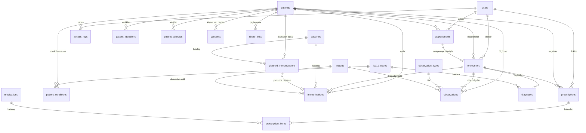

# Lokman — Veritabanı Tasarımı

> Durum: **onaylandı (v1).** Kodlamaya henüz başlanmadı.
> İlgili: [PLAN.md](PLAN.md)

Bu belge iki veritabanını kapsar:
1. **Klinik sistemi**: PostgreSQL (asıl tasarım, bölüm 1–5)
2. **Mobil uygulama**: telefondaki SQLite (bölüm 6)

---

## 0. Genel kurallar

| Kural | Açıklama |
|---|---|
| Birincil anahtar | `uuid`, Laravel `HasUuids` ile uygulamada üretilir (zaman sıralı UUIDv7). FHIR `id` alanı doğrudan bu değerdir; tekrarlanan aktarımlar mükerrer kayıt üretmez. İstisnalar: `access_logs` (`bigint identity`), kataloglarda doğal anahtarlar (`icd11_codes.code`, `atc_codes.code`, `settings.key`) |
| Zaman | Anlık zamanlar `timestamptz`, takvim günleri `date`. Kliniğin saat dilimi `settings.timezone` (varsayılan ülkeye göre: `Europe/Istanbul` ya da `Asia/Famagusta`) |
| Durum alanları | PostgreSQL `enum` tipi yerine `varchar + CHECK`. Yeni değer eklemek migration ile kolay olur |
| Silme | Klinik kayıtlar **yumuşak silinir** (`deleted_at`). Tıbbi kayıt fiziksel olarak silinmez; silme işlemi erişim loguna yazılır |
| Kim yaptı | Klinik tablolarında `created_by` / `updated_by` (→ `users.id`) |
| Dış kaynaklı kayıt | Başka kurumdan (başka Lokman kliniği, hastane, yurt dışı) gelen muayene, teşhis, reçete, aşı, ölçüm, alerji ve kronik hastalıklar **aynı tablolara** `source = external` ile yazılır, `verified` olarak doğar, onay kuyruğuna girmez, panelde salt okunur ve kurum adı etiketiyle gösterilir. Ortak kolonlar: `origin_name` (kurum adı), `origin_practitioner` (dış hekim adı), `origin_ref` (kaynak sistemdeki FHIR kimliği, `system|value`), `import_id` |
| Tekrar aktarım | `origin_ref` dosyadan gelen **her** kayıtta doldurulur (`external` ve `patient_reported`). Her tabloda kısmi tekil indeks: `unique(origin_ref) WHERE origin_ref IS NOT NULL`. Aynı kayıt tekrar gelirse yeni satır açılmaz, mevcut satır güncellenir |
| Katalogda olmayan kod | Katalog FK'leri (`icd11_code`, `type_code`) yalnızca kod katalogda varsa doldurulur. Ham kodlama her zaman `coding` (jsonb) kolonunda saklanır: `[{"system": "...", "code": "...", "display": "..."}]`. Böylece ICD-10, ICD-10-CM, SNOMED CT ya da bilinmeyen LOINC kodlu dış kayıtlar reddedilmez ve kayıpsız dışa aktarılır |
| Anlık kopya | Katalogdan seçilen ilaç, aşı ve tanının adı ve kodu kayda **kopyalanır**. Katalog sonradan değişse de eski reçete aynı kalır |
| Eklentiler | `pg_trgm` (Türkçe ad aramasında benzerlik), `btree_gist` (randevu çakışma kısıtı) |
| Adlandırma | Tablo ve kolon adları İngilizce, `snake_case`, tablo adları çoğul (Laravel geleneği). Türkçe karşılıkları aşağıda |

---

## 1. Varlık-ilişki diyagramı



Kullanıcının ilk dokümanındaki zincirle karşılığı:
`klinik → hasta kaydı → muayene → teşhis → hastalık` = `patients → encounters → diagnoses → icd11_codes`
`muayene → reçete → ilaç` = `encounters → prescriptions → prescription_items → medications`

---

## 2. Personel ve sistem

### `users`: personel (yönetici, doktor, sekreter)
> Hastalar bu tabloda **yoktur**; mobil uygulama sunucuya giriş yapmaz.

| Kolon | Tip | Kısıt / Not |
|---|---|---|
| id | uuid | PK |
| name | varchar(150) | not null |
| title | varchar(50) | ör. "Uzm. Dr." |
| email | varchar(255) | not null, `unique(lower(email))` |
| phone | varchar(30) | |
| password | varchar(255) | bcrypt/argon2 hash |
| role | varchar(20) | CHECK in (`admin`, `doctor`, `secretary`) |
| is_active | boolean | default true. Pasif kullanıcı giriş yapamaz |
| last_login_at | timestamptz | |
| remember_token | varchar(100) | Laravel |
| created_at, updated_at | timestamptz | |

### `settings`: klinik ayarları (anahtar-değer)
| Kolon | Tip | Not |
|---|---|---|
| key | varchar(100) | PK |
| value | jsonb | |
| updated_at | timestamptz | |

Başlıca anahtarlar:

| Anahtar | Açıklama |
|---|---|
| `installation_id` | Kurulumda üretilir, değişmez. FHIR'de hasta kimlik sistemi olarak kullanılır |
| `clinic.name`, `clinic.address`, `clinic.phone` | Klinik bilgileri |
| `clinic.country` | `TR` ya da `KKTC`. Kurulumda seçilir; saat dilimi, ilaç listesi, reçete türleri ve rıza metinlerinin varsayılanlarını belirler ([PLAN.md 1.6](PLAN.md)) |
| `timezone` | Varsayılan ülkeye göre: `Europe/Istanbul` (TR), `Asia/Famagusta` (KKTC) |
| `share.ttl_minutes`, `share.max_uses` | QR bağlantısının süresi ve kullanım sayısı (varsayılan 15 ve 1) |
| `share.public_base_url` | Alan adı (varsa). Yoksa QR paylaşımı kapalıdır, yalnızca dosya |
| `appointment.default_minutes` | Varsayılan randevu süresi |

### `access_logs`: erişim logu
Yalnızca ekleme yapılır. Bir veritabanı tetikleyicisi `UPDATE` ve `DELETE` işlemlerini engeller.

| Kolon | Tip | Not |
|---|---|---|
| id | bigint identity | PK |
| user_id | uuid null | → users. Paylaşım bağlantısıyla indirmede null |
| action | varchar(30) | CHECK in (`view`, `create`, `update`, `delete`, `export`, `share_create`, `share_download`, `import`, `login`, `login_failed`, `logout`) |
| subject_type | varchar(50) | ör. `patient`, `encounter` |
| subject_id | uuid null | |
| patient_id | uuid null | Hastaya göre filtrelemek için ayrı kolon |
| ip | inet | |
| user_agent | varchar(500) | |
| meta | jsonb | ör. değişen alanların adları (değerler loglanmaz) |
| created_at | timestamptz | not null |

İndeksler: `(patient_id, created_at desc)`, `(user_id, created_at desc)`, `(created_at)`

> Laravel'in kendi tabloları da kullanılacak: `sessions`, `password_reset_tokens`, `jobs`, `failed_jobs`, `cache`.

---

## 3. Hasta

### `patients`: hasta kaydı
| Kolon | Tip | Kısıt / Not |
|---|---|---|
| id | uuid | PK |
| protocol_no | varchar(20) | not null, unique. Klinik içi numara, ör. `2026-000123` (yıl + sıra) |
| first_name | varchar(100) | not null |
| last_name | varchar(100) | not null |
| birth_date | date | null olabilir |
| gender | varchar(10) | CHECK in (`female`, `male`, `unknown`), default `unknown` (FHIR değerleri; tıbbi karar desteği ikili cinsiyete bağlı olduğu için `other` kullanılmaz) |
| blood_type | varchar(3) | CHECK in (`A+`,`A-`,`B+`,`B-`,`AB+`,`AB-`,`0+`,`0-`) |
| phone | varchar(30) | |
| email | varchar(255) | |
| address | text | |
| emergency_contact_name | varchar(150) | |
| emergency_contact_phone | varchar(30) | |
| emergency_contact_relation | varchar(50) | ör. "anne" |
| internal_note | text | **Hastaya gitmez**, dışa aktarılmaz |
| created_by, updated_by | uuid | → users |
| created_at, updated_at, deleted_at | timestamptz | |

İndeksler:
- `gin (lower(first_name || ' ' || last_name) gin_trgm_ops)`: "ayse sahin" araması "Ayşe Şahin"i de bulur. Türkçe karakter sadeleştirmesi için ayrıca `search_name` üretilmiş kolon (`unaccent` + `lower`) değerlendirilecek
- `(phone)`, `(birth_date)`

### `patient_identifiers`: opsiyonel kimlikler (hiçbiri zorunlu değil)
| Kolon | Tip | Kısıt / Not |
|---|---|---|
| id | uuid | PK |
| patient_id | uuid | → patients, cascade |
| type | varchar(20) | CHECK in (`national_id` arayüzde "Kimlik": TCKN, KKTC kimlik no vb., `passport`, `lokman`, `other`) |
| system | varchar(255) | FHIR `identifier.system`. Başka Lokman kliniği ya da mobil uygulama kimliği için ör. `urn:lokman:<kurulum-uuid>:patient`, `urn:lokman:app:<uuid>:profile` |
| value | varchar(100) | not null. **Doğrulama yapılmaz**; yalnızca baştaki/sondaki boşluklar temizlenir |
| issuer | varchar(50) | Veren ülke: `TR`, `KKTC` ya da ISO 3166 kodu. Kimlik no girilirken varsayılan `clinic.country` |
| created_at, updated_at | timestamptz | |

Kısıt: `unique(type, system, value)`, aynı kimlik iki hastaya verilemez.
FHIR: `Patient.identifier[]` dizisine eklenir. Bu kurulumun kendi kimliği (`installation_id` + hasta UUID) burada tutulmaz, `patients.id`'den üretilir. Dosyadan gelen diğer Lokman kimlikleri (başka klinik, mobil profil) burada saklanır; aynı kişiden ikinci dosya geldiğinde hasta otomatik bulunur.

### `patient_allergies`: alerjiler
| Kolon | Tip | Not |
|---|---|---|
| id | uuid | PK |
| patient_id | uuid | → patients |
| substance | varchar(200) | not null, ör. "Penisilin" (görünen ad) |
| category | varchar(20) | CHECK in (`medication`, `food`, `environment`, `other`) |
| atc_code | varchar(10) null | İlaç alerjisinde ATC kodu ya da grubu, ör. `J01C` (penisilinler) ya da `J01CA04` (amoksisilin). Panelde `atc_codes` listesinden seçilir; FK değildir, çünkü dosyadan gelen kod listede olmayabilir |
| active_ingredient | varchar(300) null | İlaç alerjisinde etken madde (`medications.active_ingredient` ile aynı yazım) |
| coding | jsonb | Dosyadan gelen ham kodlama (bkz. genel kurallar) |
| reaction | varchar(300) | ör. "ürtiker" |
| severity | varchar(10) | CHECK in (`mild`, `moderate`, `severe`) |
| note | text | |
| source | varchar(20) | CHECK in (`clinic`, `patient_reported`, `external`) |
| verification | varchar(10) | CHECK in (`verified`, `pending`, `rejected`). Ör. ebeveynin mobilde çocuğu için girdiği alerji `pending` gelir |
| verified_by, verified_at | | |
| origin_name, origin_ref | varchar | Dosyadan gelen alerji için (bkz. genel kurallar) |
| import_id | uuid null | → imports |
| created_by, timestamps, deleted_at | | |

İndeksler: `(patient_id)`, `(atc_code)`, `unique(origin_ref) WHERE origin_ref IS NOT NULL`
FHIR: `AllergyIntolerance` (`code`: ATC kodu, yoksa yalnızca `text`). Onay bekleyen alerji de reçete ekranındaki uyarıda gösterilir ("hasta beyanı" etiketiyle); güvenlik açısından doğrulanmasını beklemek doğru olmaz.

**İlaç–alerji uyarısı:** reçeteye eklenen ilaç için, hastanın `rejected` olmayan alerjileri taranır:
- `prescription_items.atc_code`, alerjinin `atc_code` değeriyle **başlıyorsa** uyarı (ör. `J01CA04` ⊂ `J01C`)
- etken madde eşitse uyarı
- `category = medication` olup kodu ve etken maddesi olmayan alerji varsa genel uyarı: "Kodsuz ilaç alerjisi var, kontrol edin"

Panelde alerji girerken madde `atc_codes` ve ilaç katalogundaki etken maddelerden aranarak seçilir; bulunamazsa serbest metin girilir.

### `patient_conditions`: kronik ve geçirilmiş hastalıklar (problem listesi)
| Kolon | Tip | Not |
|---|---|---|
| id | uuid | PK |
| patient_id | uuid | → patients |
| icd11_code | varchar(20) null | → icd11_codes. Yalnızca kod katalogda varsa |
| coding | jsonb | Ham kodlama (dosyadan gelen ya da katalogda olmayan kod) |
| description | varchar(300) | not null (kod yoksa serbest metin) |
| onset_date | date | |
| status | varchar(10) | CHECK in (`active`, `resolved`), default `active`. `resolved` = geçirilmiş hastalık |
| resolved_date | date null | Hastalığın geçtiği tarih (FHIR `abatementDateTime`) |
| note | text | |
| source | varchar(20) | CHECK in (`clinic`, `patient_reported`, `external`) |
| verification | varchar(10) | CHECK in (`verified`, `pending`, `rejected`) |
| verified_by, verified_at | | |
| origin_name, origin_ref | varchar | Dosyadan gelen kayıt için (bkz. genel kurallar) |
| import_id | uuid null | → imports |
| created_by, timestamps, deleted_at | | |

İndeks: `unique(origin_ref) WHERE origin_ref IS NOT NULL`
FHIR: `Condition` (category = `problem-list-item`, `clinicalStatus` = `status`). Geçirilmiş hastalıklar IPS'te ayrı bölümde (`11348-0`) gider

### `consents`: kişisel veri aydınlatma ve açık rıza
| Kolon | Tip | Not |
|---|---|---|
| id | uuid | PK |
| patient_id | uuid | → patients |
| type | varchar(30) | CHECK in (`disclosure` aydınlatma, `explicit_consent` açık rıza, `data_sharing` mobil paylaşım). Metin ülkeye göre (TR: KVKK, KKTC: kendi yasası) |
| text_version | varchar(20) | Hangi metin sürümü onaylandı, ör. `TR-2026-1`, `KKTC-2026-1` |
| granted | boolean | |
| granted_at | timestamptz | |
| revoked_at | timestamptz null | |
| document_path | varchar(500) | Imzalı form taraması (opsiyonel) |
| recorded_by | uuid | → users |
| created_at | timestamptz | |

Kural: geçerli bir `data_sharing` rızası yoksa QR ya da dosya paylaşımı yapılamaz.

---

## 4. Klinik süreç

### `appointments`: randevu
Doktor kendi randevularını, sekreter tüm doktorların randevularını girer ve yönetir.
| Kolon | Tip | Kısıt / Not |
|---|---|---|
| id | uuid | PK |
| doctor_id | uuid | → users (rol = doctor) |
| patient_id | uuid | → patients |
| created_by | uuid | → users. Randevuyu giren (doktor ya da sekreter) |
| starts_at | timestamptz | not null |
| ends_at | timestamptz | not null, CHECK `ends_at > starts_at` |
| status | varchar(15) | CHECK in (`planned`, `arrived`, `completed`, `no_show`, `cancelled`) |
| reason | varchar(300) | Geliş nedeni |
| note | text | |
| cancelled_at | timestamptz | |
| created_by, timestamps, deleted_at | | |

**Çakışma kısıtı:** aynı doktora üst üste randevu verilemez.
```sql
EXCLUDE USING gist (doctor_id WITH =, tstzrange(starts_at, ends_at) WITH &&)
  WHERE (status NOT IN ('cancelled','no_show') AND deleted_at IS NULL)
```
İndeks: `(doctor_id, starts_at)`, `(patient_id, starts_at)`
FHIR: `Appointment` (yalnızca gelecek randevular paylaşılır)

### `encounters`: muayene
| Kolon | Tip | Kısıt / Not |
|---|---|---|
| id | uuid | PK |
| patient_id | uuid | → patients |
| doctor_id | uuid null | → users. CHECK: `source = 'clinic'` ise dolu olmalı |
| appointment_id | uuid null | → appointments, unique (bir randevudan tek muayene) |
| source | varchar(10) | CHECK in (`clinic`, `external`), default `clinic` |
| origin_name, origin_practitioner, origin_ref | varchar | Dış kaynaklı kayıtlar için (bkz. genel kurallar). `unique(origin_ref) WHERE origin_ref IS NOT NULL` |
| import_id | uuid null | → imports |
| started_at | timestamptz | not null |
| ended_at | timestamptz | |
| complaint | text | Şikayet |
| history | text | Hikaye / anamnez |
| findings | text | Fizik muayene bulguları |
| plan | text | Öneriler ve tedavi planı (**hastaya gider**) |
| internal_note | text | Hekim notu (**hastaya gitmez**) |
| status | varchar(20) | CHECK in (`finished`, `entered_in_error`), default `finished` |
| created_by, updated_by, timestamps, deleted_at | | |

İndeks: `(patient_id, started_at desc)`, `(doctor_id, started_at desc)`
FHIR: `Encounter`. Şikayet `reasonCode`, bulgular ve plan extension olarak taşınır. `internal_note` dışa aktarılmaz. Dış kaynaklı muayenenin teşhisleri (`diagnoses`) muayeneyle birlikte dış kaynaklı sayılır.

### `diagnoses`: teşhis
| Kolon | Tip | Kısıt / Not |
|---|---|---|
| id | uuid | PK |
| encounter_id | uuid | → encounters, cascade |
| icd11_code | varchar(20) null | → icd11_codes (hastalık). Yalnızca kod katalogda varsa |
| coding | jsonb | Ham kodlama. Dış kaynaklı muayenede katalogda olmayan kod (ör. ICD-10, ICD-10-CM) burada kalır |
| description | varchar(300) | not null (katalogdan kopya ya da serbest metin) |
| rank | varchar(10) | CHECK in (`primary`, `secondary`) |
| verification | varchar(15) | CHECK in (`provisional` ön tanı, `confirmed` kesin tanı) |
| note | text | |
| created_at, updated_at | timestamptz | |

FHIR: `Condition` (category = `encounter-diagnosis`, `verificationStatus`)

### `prescriptions`: reçete
| Kolon | Tip | Kısıt / Not |
|---|---|---|
| id | uuid | PK |
| patient_id | uuid | → patients |
| encounter_id | uuid null | → encounters |
| doctor_id | uuid null | → users. CHECK: `source = 'clinic'` ise dolu olmalı |
| source | varchar(10) | CHECK in (`clinic`, `external`), default `clinic` |
| origin_name, origin_practitioner, origin_ref | varchar | Dış kaynaklı reçete için |
| import_id | uuid null | → imports |
| issued_at | timestamptz | not null |
| type | varchar(10) | CHECK in (`normal`, `red`, `green`, `purple`, `orange`): reçete türü (normal / kırmızı / yeşil / mor / turuncu). Panel yalnızca `clinic.country` için geçerli türleri gösterir; KKTC türleri doğrulanana kadar orada yalnızca `normal` |
| erecete_no | varchar(30) | e-Reçete numarası (varsa, elle girilir) |
| note | text | |
| created_by, timestamps, deleted_at | | |

### `prescription_items`: reçetedeki ilaçlar (doz ve kullanım zamanı)
| Kolon | Tip | Kısıt / Not |
|---|---|---|
| id | uuid | PK |
| prescription_id | uuid | → prescriptions, cascade |
| medication_id | uuid null | → medications |
| medication_name | varchar(300) | not null (kopya) |
| atc_code | varchar(10) | (kopya) |
| dose | numeric(8,3) | not null, > 0. Ör. 0.5, 1, 2 |
| dose_unit | varchar(20) | ör. tablet, kapsül, ml, damla, puf, ölçek |
| route | varchar(20) | CHECK in (`oral`, `topical`, `inhalation`, `injection`, `nasal`, `ophthalmic`, `otic`, `rectal`, `other`) |
| times_of_day | jsonb | Ör. `["08:00","20:00"]`. CHECK: dizi ve 1–12 eleman. **Mobil bildirimler buradan kurulur** |
| as_needed | boolean | default false. "Gerektiğinde" kullanımda bildirim kurulmaz |
| start_date | date | not null |
| duration_days | integer null | null = sürekli kullanım. CHECK > 0 |
| box_count | smallint | Kutu adedi |
| instructions | varchar(300) | ör. "tok karnına" |
| stopped_at | timestamptz | Hekim tedaviyi erken sonlandırdıysa |
| stop_reason | varchar(300) | |
| sort_order | smallint | |
| created_at, updated_at | timestamptz | |

FHIR: her kalem bir `MedicationRequest`. Aynı reçetenin kalemleri `groupIdentifier` ile gruplanır. Saatler `timing.repeat.timeOfDay`, süre `boundsPeriod` alanına gider.
> Doz "alındı / atlandı" kaydı **yalnızca mobilde** tutulur; klinik sistemine gelmez.

### `immunizations`: aşı kaydı
Muayeneden ayrı bir tablodur, muayene bağlantısı opsiyoneldir (ilk dokümandaki karar).

| Kolon | Tip | Kısıt / Not |
|---|---|---|
| id | uuid | PK |
| patient_id | uuid | → patients |
| encounter_id | uuid null | → encounters |
| vaccine_id | uuid null | → vaccines |
| vaccine_name | varchar(200) | not null (kopya) |
| vaccine_code | varchar(30) | (kopya) |
| dose_number | smallint | |
| administered_on | date | not null |
| lot_number | varchar(50) | |
| expiration_date | date | Aşının son kullanma tarihi |
| site | varchar(30) | Uygulama bölgesi, ör. sol deltoid |
| performer_id | uuid null | → users (klinikte yapıldıysa) |
| performer_name | varchar(150) | Dışarıda yapıldıysa yapan kişi |
| origin_name, origin_ref | varchar | Dış kaynaklı aşı için kurum adı ve kaynak kimlik |
| source | varchar(20) | CHECK in (`clinic`, `patient_reported`, `external`) |
| verification | varchar(10) | CHECK in (`verified`, `pending`, `rejected`). Klinikte yapılan aşı `verified` olarak doğar |
| verified_by | uuid null | → users |
| verified_at | timestamptz | |
| rejection_reason | varchar(300) | |
| import_id | uuid null | → imports (hastanın dosyasından geldiyse) |
| note | text | |
| created_by, timestamps, deleted_at | | |

Kural: `source = patient_reported` ise `verification` `pending` olarak başlar; doktor onaylar ya da reddeder.
İndeks: `(patient_id, administered_on desc)`, kısmi indeks `(verification) WHERE verification = 'pending'` (onay kuyruğu)
FHIR: `Immunization`.
> Panelde aşı girilirken "sonraki doz tarihi" alanı doldurulursa ayrı bir kolona yazılmaz; otomatik olarak bir `planned_immunizations` kaydı oluşturulur. Böylece gelecek aşıların tek bir kaynağı olur.

### `planned_immunizations`: planlanan aşılar
Yapılacak aşılar burada tutulur. Örnekler: ateş nedeniyle kontrole ertelenen Td, bir aşının sonraki dozu, sezonluk grip aşısı. Ulusal aşı takvimi kapsam dışıdır; planlar elle ya da sonraki doz olarak oluşur.

| Kolon | Tip | Kısıt / Not |
|---|---|---|
| id | uuid | PK |
| patient_id | uuid | → patients |
| vaccine_id | uuid null | → vaccines |
| vaccine_name | varchar(200) | not null (kopya) |
| vaccine_code | varchar(30) | (kopya) |
| dose_number | smallint | |
| due_on | date | not null. Yapılması gereken tarih |
| status | varchar(10) | CHECK in (`planned`, `completed`, `cancelled`), default `planned` |
| origin | varchar(20) | CHECK in (`manual` doktor/sekreter elle, `next_dose` önceki aşının sonraki dozu) |
| encounter_id | uuid null | → encounters (planın yapıldığı muayene) |
| previous_immunization_id | uuid null | → immunizations (`origin = next_dose` ise önceki doz) |
| immunization_id | uuid null | → immunizations, unique. Aşı yapılınca bağlanır, durum `completed` olur |
| reason | varchar(300) | ör. "Ateşli olduğu için kontrole ertelendi" (**hastaya gider**) |
| cancelled_reason | varchar(300) | |
| created_by, timestamps, deleted_at | | |

Kurallar:
- Aşı kaydedilirken hastanın aynı aşıya ait `planned` kaydı varsa panel "Planlanan aşı yapıldı olarak işaretlensin mi?" diye sorar. Onaylanırsa `immunization_id` bağlanır.
- `due_on` geçmiş ve durumu `planned` olan kayıt panelde "gecikmiş aşı" olarak listelenir.

İndeksler: `(patient_id, due_on) WHERE status = 'planned'`, `(due_on) WHERE status = 'planned'` (panelde "bu hafta yapılacak aşılar" listesi)
FHIR: `ImmunizationRecommendation` (`dateCriterion` = `due_on`). Mobilde aşı hatırlatması bu kayıtlardan kurulur.

### `observations`: sağlık takibi ve vital bulgular
| Kolon | Tip | Kısıt / Not |
|---|---|---|
| id | uuid | PK |
| patient_id | uuid | → patients |
| encounter_id | uuid null | → encounters (muayenede ölçüldüyse) |
| type_code | varchar(30) null | → observation_types. Dosyadan gelen ölçüm, LOINC koduyla türe eşlenir; eşlenemezse null |
| coding | jsonb | Ham kodlama (LOINC). CHECK: `type_code` ya da `coding` dolu olmalı; `source = 'clinic'` ise `type_code` dolu olmalı |
| value | numeric(10,3) | not null |
| value2 | numeric(10,3) | Tansiyonda küçük değer |
| unit | varchar(20) | Türden kopya; eşlenemeyen ölçümde dosyadaki birim (UCUM) |
| measured_at | timestamptz | not null |
| source | varchar(20) | CHECK in (`clinic`, `patient_reported`, `external`) |
| verification | varchar(10) | CHECK in (`verified`, `pending`, `rejected`) |
| verified_by, verified_at | | |
| import_id | uuid null | → imports |
| origin_name, origin_ref | varchar | Dış kaynaklı ölçüm için |
| note | varchar(300) | |
| recorded_by | uuid null | → users |
| created_at, updated_at, deleted_at | timestamptz | |

İndeks: `(patient_id, type_code, measured_at desc)`
FHIR: `Observation` (LOINC kodu ve UCUM birimi türden gelir; tansiyon `component` ile). Türü eşlenemeyen ölçümler grafiklerde "diğer ölçümler" altında listelenir, normal aralık uyarısı verilmez.

---

## 5. Kataloglar ve aktarım

### `medications`: ilaç katalogu (TİTCK ya da KKTC listesinden)
| Kolon | Tip | Not |
|---|---|---|
| id | uuid | PK |
| barcode | varchar(20) | unique (null hariç). İlaç listesinde eşleştirme anahtarı |
| name | varchar(300) | not null |
| active_ingredient | varchar(300) | |
| active_ingredient_en | varchar(300) | Uluslararası ad (INN). Dışa aktarımda eklenir |
| atc_code | varchar(10) | İlaç listesinden (5. düzey). İlaç–alerji uyarısı bu koda dayanır |
| form | varchar(50) | tablet, şurup… |
| strength | varchar(100) | |
| manufacturer | varchar(200) | |
| prescription_type | varchar(10) | normal / red / green / purple / orange |
| is_active | boolean | Listeden çıkan ilaç pasifleşir, silinmez |
| source | varchar(10) | CHECK in (`titck`, `kktc`, `manual`) |
| synced_at | timestamptz | Son liste güncellemesi |
| created_at, updated_at | timestamptz | |

İndeks: `gin (name gin_trgm_ops)`, `(atc_code)`

### `icd11_codes`: hastalık katalogu (ICD-11 MMS)
Lokman Terminoloji Paketi'nden yüklenir; klinikte ayrıca liste yüklenmez. Kaynak, lisans ve gerekçe: [TERMINOLOJI.md](TERMINOLOJI.md).

| Kolon | Tip | Not |
|---|---|---|
| code | varchar(20) | PK, ör. `CA03`. v0.1'de yalnızca temel (stem) kodlar; kod birleştirme yok |
| name | varchar(500) | Türkçe ad (WHO resmî çevirisi; eksikse İngilizce ad gösterilir) |
| name_en | varchar(500) | İngilizce ad |
| parent_code | varchar(20) null | → icd11_codes (bölüm, blok, kategori hiyerarşisi) |
| is_selectable | boolean | Yalnızca alt düzey kodlar teşhis olarak seçilebilir |
| release | varchar(10) | ICD-11 sürümü, ör. `2026-01` |

İlişkili arama tablosu `icd11_search_terms` (code, term, lang, kind: `index` WHO indeks terimi | `lay` proje halk dili eş anlamlısı). ICD-11 içeriği değiştirilmez; halk dili terimleri ayrı satırlardır.

FHIR: `system = http://id.who.int/icd/release/11/mms`. Dış kaynaktan gelen ICD-10 kodları `coding` kolonunda kalır; WHO eşleme tablosunun lisansı uygunsa ICD-11 karşılığı önerilir.

İndeks: `gin (name gin_trgm_ops)`, `icd11_search_terms (term gin_trgm_ops)`

### `atc_codes`: alerji için ATC seçim listesi
İlaç alerjisi girerken madde ya da ilaç grubu seçmek için kullanılır (ör. `J01C` penisilinler). **Tam ATC sınıflandırması değildir.**

WHO'nun ATC/DDD Index'i depoya konmaz ve kurulumla dağıtılmaz. Index'in tam listesi ücretli satılıyor, kullanım koşulları da (bilinen hâliyle; resmi metin F1'de teyit edilir) ticari amaçlı dağıtımı ve içeriği değiştirmeyi kısıtlıyor; MIT lisanslı Lokman'ı başkaları ticari olarak kurabileceği için bu liste kullanılmaz. Uyarı için tam listeye gerek yok: ilaçların 5. düzey ATC kodu TİTCK listesinden gelir, grup koddan türetilir (`J01CA04` → ilk 4 karakter `J01C`), grup adlarını proje kendi yazar.

Satırlar üç kaynaktan gelir:

| `source` | Ne | Nasıl |
|---|---|---|
| `lokman` | Alerjide sık geçen ilaç grupları, 20–40 satır: penisilinler, sefalosporinler, karbapenemler, sülfonamidler, makrolidler, kinolonlar, tetrasiklinler, NSAİİ'ler, opioidler, iyotlu kontrast maddeler, lokal anestezikler, antiepileptikler… | Proje ekibinin yazdığı Türkçe ve İngilizce adlarla seed dosyası (`backend/database/seeders/data/atc_allergy_groups.php`). Her satırda yalnızca kod ve kendi yazdığımız ad bulunur |
| `titck` | Etken maddeler (5. düzey kodlar) | TİTCK ilaç listesi içe aktarılırken `medications` tablosundaki farklı (`atc_code`, `active_ingredient`, `active_ingredient_en`) üçlülerinden üretilir. Ad TİTCK listesindeki etken madde adıdır |
| `manual` | Klinik eklemesi | Panelden (yönetici) |

| Kolon | Tip | Not |
|---|---|---|
| code | varchar(10) | PK, ör. `J01C`, `J01CA04`. CHECK: ATC biçimi (`^[A-Z]([0-9]{2}([A-Z]([A-Z]([0-9]{2})?)?)?)?$`) |
| name | varchar(300) | not null. Türkçe ad |
| name_en | varchar(300) | İngilizce ad (dışa aktarımda `display`) |
| level | smallint | 1–5. Koddan hesaplanır (uzunluk 1, 3, 4, 5, 7) |
| source | varchar(10) | CHECK in (`lokman`, `titck`, `manual`) |
| is_active | boolean | |

İndeks: `gin (name gin_trgm_ops)`
TİTCK içe aktarımı `lokman` ve `manual` satırlarının üzerine yazmaz.

### `vaccines`: aşı katalogu
| Kolon | Tip | Not |
|---|---|---|
| id | uuid | PK |
| code | varchar(30) | unique, ör. `HEPB`, `KKK` |
| name | varchar(200) | |
| name_en | varchar(200) | İngilizce ad |
| atc_code | varchar(10) | |
| description | text | |
| is_active | boolean | |

### `observation_types`: ölçüm türleri
Varsayılanlar: kilo, boy, tansiyon, nabız, ateş, kan şekeri, SpO₂. Klinik yeni tür ekleyebilir, ör. HbA1c.

| Kolon | Tip | Not |
|---|---|---|
| code | varchar(30) | PK, ör. `blood_pressure` |
| name | varchar(100) | "Tansiyon" |
| name_en | varchar(100) | "Blood pressure" |
| unit | varchar(20) | "mmHg" |
| ucum | varchar(20) | "mm[Hg]" |
| loinc | varchar(20) | "85354-9" |
| has_second_value | boolean | Tansiyon için true |
| loinc_1, loinc_2 | varchar(20) | Bileşen kodları (8480-6 / 8462-4) |
| normal_min, normal_max | numeric | Normal aralık uyarısı |
| normal2_min, normal2_max | numeric | |
| is_active | boolean | |

### `share_links`: QR paylaşım bağlantıları
| Kolon | Tip | Not |
|---|---|---|
| id | uuid | PK |
| patient_id | uuid | → patients |
| token_hash | char(64) | unique. Token'ın SHA-256'sı; token'ın kendisi saklanmaz |
| channel | varchar(10) | CHECK in (`internet`). Yerel ağ QR'ı (`lan`) v0.1 sonrasında eklenecek |
| scope | jsonb | `{"all": true}` ya da `{"encounters": ["<uuid>", ...]}` |
| expires_at | timestamptz | not null |
| max_uses | smallint | |
| use_count | smallint | default 0 |
| last_used_at | timestamptz | |
| revoked_at | timestamptz | Panelden erken iptal |
| created_by | uuid | → users |
| created_at | timestamptz | |

Geçerlilik: `revoked_at IS NULL AND expires_at > now() AND use_count < max_uses`. Her indirme `access_logs` tablosuna `share_download` olarak yazılır.

### `imports`: içe aktarım kayıtları
| Kolon | Tip | Not |
|---|---|---|
| id | uuid | PK |
| type | varchar(20) | CHECK in (`fhir_bundle`, `fhir_ips`, `titck_medications`, `patients_csv`) |
| file_name | varchar(255) | |
| file_sha256 | char(64) | Aynı dosya tekrar yüklenirse uyarı verilir |
| status | varchar(20) | CHECK in (`awaiting_match` hasta eşleşmesi bekliyor, `completed`, `partial`, `failed`) |
| patient_id | uuid null | → patients (eşleşen hasta) |
| payload | jsonb | Ham FHIR paketi. Eşleştirme sonrası yeniden işlemek ve denetim için saklanır |
| summary | jsonb | Ör. `{"immunizations": 2, "observations": 14, "skipped": 1, "warnings": [...]}` |
| imported_by | uuid | → users |
| created_at, updated_at | timestamptz | |

Akış ([PLAN.md 4.4](PLAN.md) ile aynı):
1. Dosya yüklenir. Dosyadaki bilinen bir identifier (bu kurulumun `installation_id` + hasta UUID'si ya da `patient_identifiers` tablosundaki başka Lokman kimliği) hastayı otomatik bulur; bulunamazsa durum `awaiting_match` olur, kullanıcı hastayı elle eşleştirir ya da yeni hasta oluşturur.
2. Her kayıt kaynağına göre işlenir:
   - bu kurulumun kendi kaydı → atlanır
   - `origin_ref` değeri zaten kayıtlı → mevcut satır güncellenir
   - hasta beyanı → `source = patient_reported`, `verification = pending`, doktorun onay kuyruğuna düşer
   - başka kurumun kaydı → `source = external`, `verification = verified`, salt okunur; onay kuyruğuna girmez
3. Sonuç `summary` alanına yazılır.

Sekreter eşleştirme ekranında yalnızca hasta kimlik bilgilerini ve `summary` sayılarını görür; `payload` ve kayıt içerikleri sekretere gösterilmez.

---

## 6. Mobil uygulama: yerel SQLite (drift)

Sunucu yok; veri telefonda durur. Klinikten gelen kayıtların kimliği klinikteki UUID'dir; hastanın kendi girdiği kayıtlara uygulama UUID üretir. Aynı dosya iki kez içe aktarılırsa kayıt güncellenir.

Uygulama ilk açılışta kalıcı bir **uygulama kurulum kimliği** üretir. Her profil, dışa aktarımda `urn:lokman:app:<uygulama-kurulum-uuid>:profile` kimliğiyle tanınır. Böylece hiçbir klinikte kaydı olmayan bir çocuk profili de alıcı klinikte tanınabilir.

| Tablo | İçerik |
|---|---|
| `profiles` | Aile üyeleri: id (uuid), ad, soyad, doğum tarihi, cinsiyet, kan grubu, renk/avatar. Ebeveyn çocuk profilini klinik dosyası olmadan açabilir |
| `profile_links` | Profil ↔ klinik eşlemesi: `installation_id`, klinikteki hasta UUID'si, klinik adı. Bir profil birden çok kliniğe bağlanabilir |
| `encounters` | Muayene: klinikten gelenler ve kullanıcının kendi eklediği doktor ziyaretleri. Tarih, hastane/klinik (`location`), doktor, şikayet, bulgular, öneriler, kullanıcının notu (`note`) |
| `diagnoses` | Teşhis: ad, `code` + `code_system` (kullanıcı katalogdan seçtiyse ICD-11 MMS, dosyadan gelenlerde kaynağın sistemi), ön/kesin (`verification`), bağlı muayene |
| `prescriptions`, `medications` | Reçete ve kalemleri: doz, saatler, başlangıç, süre. `encounter_id`: ilacın yazıldığı muayene/ziyaret |
| `dose_events` | Doz kaydı: `medication_id`, planlanan zaman, `taken` / `skipped`, işaretlenme zamanı. **Yalnızca mobilde kalır, hiçbir dışa aktarıma girmez** |
| `immunizations` | Aşılar. `source`: klinikten gelen (`clinic`) ya da hastanın girdiği (`self`) |
| `immunization_due` | Planlanan aşılar: klinikten gelen `ImmunizationRecommendation` kayıtları |
| `observations` | Ölçümler (klinikten gelen + hastanın girdiği) |
| `appointments` | Klinikten gelen gelecek randevular |
| `allergies`, `conditions` | Alerjiler, devam eden ve geçirilmiş hastalıklar (`conditions.status`: `active` / `resolved`, `resolved_date`; `code` + `code_system` tanı ile aynı kuralda). `source`: klinikten gelen ya da kullanıcının girdiği (ör. annenin çocuğu için girdiği alerji) |
| `fhir_resources` | Her kaynağın ham FHIR JSON'u (`resource_type`, `id`, `profile_id`, `json`, `last_updated`). Kayıpsız dışa aktarım ve ileride yeni alanlar için |
| `import_history` | Ne zaman, hangi klinikten, kaç kayıt geldi |
| `app_settings` | Uygulama kurulum kimliği, bildirim tercihleri, son tam dışa aktarım zamanı (yedek hatırlatması için), kodsuz kayıtların eşleştirildiği terminoloji paketi sürümü |

Hastalık ve tanı kataloğu veritabanında değil, uygulamanın varlıklarında gömülü düz metin olarak durur (`mobile/assets/terminology/`, bkz. [TERMINOLOJI.md](TERMINOLOJI.md)): tablolarda yalnızca seçilen kod ve kod sistemi tutulur, katalog FK'si yoktur. Paket yenilendiğinde kullanıcının kodsuz kayıtları bir kez taranıp adı birebir eşleşenlere kod yazılır.

Bildirimler bu tablolardan hesaplanır ve cihazda zamanlanır: `medications.times_of_day` ile doz bildirimleri, `immunization_due` ile aşı bildirimleri, `appointments` ile randevu bildirimleri.

---

## 7. Kesinleşen tasarım kararları
- Alerjiler ve kronik hastalıklar ayrı, yapısal tablolarda; hasta beyanı onay akışıyla.
- Teşhiste ön tanı / kesin tanı ayrımı var (`diagnoses.verification`).
- Hastalık ve teşhis kodlaması ICD-11 (`icd11_codes`), mobil ve klinikte aynı paketten. ICD-10 yalnızca dış kayıtlarda `coding` içinde bulunur.
- Reçete türü (normal / kırmızı / yeşil / mor / turuncu) ve kutu adedi tutulur.
- Muayenede hikaye, bulgular, hastaya giden öneriler (`plan`) ve iç not ayrı alanlar.
- Protokol numarası yıl + sıra: `2026-000123` (yıl başında sıra sıfırlanır; PostgreSQL sequence + yıl).
- Kimlik numaraları (TCKN, KKTC kimlik no vb.) tek bir `national_id` türüyle, doğrulamasız ve düz saklanır (arama için). Koruma veritabanı/disk düzeyinde şifreleme, rol bazlı erişim ve erişim logu ile sağlanır.
- Başka kurumdan gelen kayıtlar aynı tablolara `source = external` ile eklenir; onay kuyruğuna girmez. Yalnızca hasta beyanı onay bekler.
- Dosyadan gelen her kayıtta `origin_ref` tutulur ve tekildir; tekrar aktarım kayıt çoğaltmaz (alerji ve kronik hastalık dahil).
- Katalogda olmayan kodlar reddedilmez; ham kodlama `coding` kolonunda saklanır, katalog FK'si boş kalır. Mobilde aynı kural kod + kod sistemi çiftiyle işler.
- İlaç alerjisi ATC kodu / etken maddeyle kodlanır; ilaç–alerji uyarısı ATC öneki ve etken madde eşleşmesiyle çalışır.
- WHO ATC/DDD Index dağıtılmaz. `atc_codes` yalnızca projenin yazdığı alerji grupları ile TİTCK listesinden türetilen etken maddeleri içerir.
- Sekreter klinik içeriği göremez ve dışa aktaramaz; içe aktarımda yalnızca hasta eşleştirmesi yapar.
- Planlanan aşılar ayrı tabloda (`planned_immunizations`).
